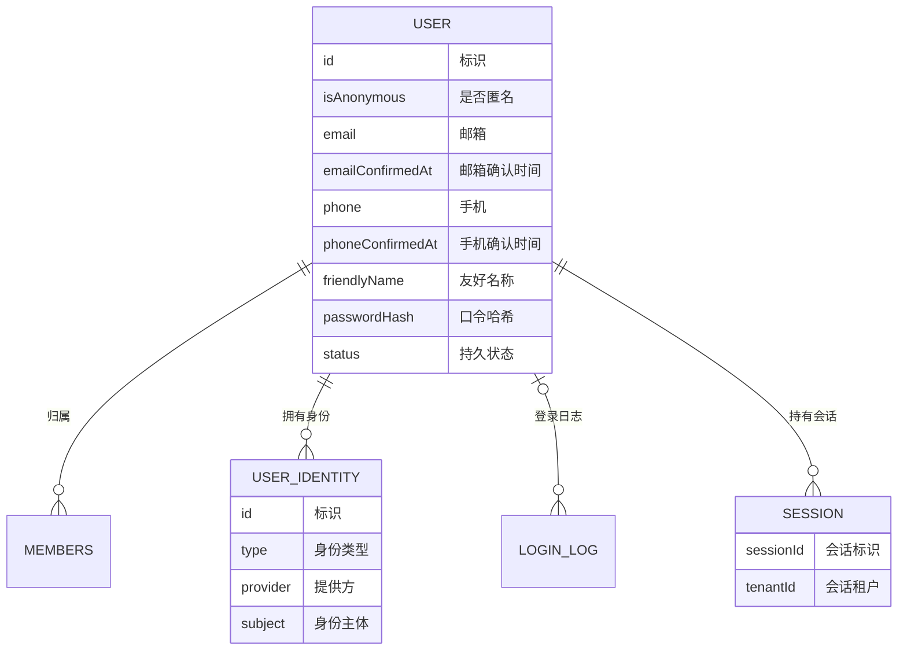

# 认证模块 — 数据模型

> 该文档是[认证模块PRD](./认证模块PRD.md)的子章节。

## 实体关系

## 实体

### User（用户）

可登录账号。

| 属性              | 类型            | 必填 | 默认值 | 约束说明                                                     |
| ----------------- | --------------- | ---- | ------ | ------------------------------------------------------------ |
| id                | 标识            | 是   | 无     | 业务主键                                                     |
| isAnonymous       | 布尔            | 是   | 否     | 是否匿名用户；为真时不得有任何 UserIdentity；绑定任一身份后须为假 |
| email             | 文本            | 否   | 无     | 接口明文最长 64；先 trim 再转小写，之后所有校验、查找、限流和唯一性判断均使用规范化值；唯一 |
| emailConfirmedAt  | 时间戳          | 否   | 无     | 邮箱归属确认时间；空表示尚未验证邮箱归属；邮箱值变更时须清空 |
| phone             | 文本            | 否   | 无     | 非唯一；本期不用于注册或主账号标识；可作为已验证的短信验证码接收地址，多个用户可共用 |
| phoneConfirmedAt  | 时间戳          | 否   | 无     | 手机号归属确认时间；空表示尚未验证手机号归属；手机号值变更时须清空 |
| lastLoginAt       | 时间戳          | 否   | 无     | 用户最近登录时间；                                           |
| passwordHash      | 口令哈希        | 否   | 无     | 只存成熟慢哈希结果；禁止明文；UTF-8 超过 72 字节拒绝接受；长度与复杂度按主 PRD R-04 |
| passwordUpdatedAt | 时间戳          | 否   | 无     | 上次改密时间                                                 |
| passwordHistory   | 口令哈希列表    | 否   | 空     | 曾用口令哈希，最多 5，新在前                                |
| friendlyName      | 文本            | 是   | 无     | 展示名（PRD 术语；对外显示）                                         |
| gender            | 枚举Gender      | 是   | 未知   | 认证主路径不依赖                                             |
| avatar            | 标识            | 否   | 无     | 头像引用                                                     |
| status            | 枚举 UserStatus | 是   | 无     | 持久态：自助注册初始为待验证，邮箱验证后转正常；管理员创建按用户管理规则设定；不含临时锁。待验证账号按主 PRD R-21 在 7 天后清理 |
| builtin           | 布尔            | 是   | 否     | 是否系统内置                                                 |
| createdAt         | 时间戳          | 是   | 无     | 创建时间                                                     |
| updatedAt         | 时间戳          | 是   | 无     | 修改时间                                                     |

邮箱资料变更由平台管理模块负责；以下约束定义数据一致性：输入先 trim 并转小写；在同一事务内校验新邮箱在 `User.email` 及 EMAIL 类型 `UserIdentity.subject` 中唯一、更新 `User.email`、清空 `emailConfirmedAt`，并同步更新该用户的 EMAIL 类型 `UserIdentity.subject`（如存在）；任一步失败则整体回滚。新邮箱重新验证成功后才写入新的 `emailConfirmedAt`。

说明：临时锁是缓存运行态，不是用户持久属性。注销本期不单列状态；删除用户后会话必须失效。邮箱 / 手机归属以 `emailConfirmedAt` / `phoneConfirmedAt` 是否非空判定，不另建归属证明实体。匿名用户（`isAnonymous=true`）在绑定身份前没有任何 UserIdentity。

### 缓存运行态（非持久化实体）

登录失败计数与一次性凭证只存于多实例共享缓存，不属于数据库实体，不进入实体关系图。缓存服务不可用或写入失败时，登录、OTP 发送 / 校验及相关凭证校验返回暂时不可用，不把缓存错误当作“未锁定”或“验证通过”。缓存键中的邮箱统一使用 trim + 小写后的规范化值；标识摘要使用带密钥 HMAC，缓存键不暴露原始邮箱或 IP。

#### 登录失败与限流

按规范化邮箱账号标识和来源 IP 分开维护登录失败运行态；OTP 发送限频按所选收件邮箱或手机号单独维护，互不替代，也不按租户拆分。真实标识与不存在标识使用相同的标识计数流程。建议采用 Redis Sorted Set 记录窗口内失败时间，配合原子脚本完成“判锁 / 计数 / 设置 TTL”；IP 的限流与撞库计数使用独立键和独立窗口。键可采用 `auth:login:fail:email:{HMAC(normalizedEmail)}`、`auth:login:fail:ip:{HMAC(ip)}`。锁定截止和验证码要求按主 PRD R-06、R-07、R-28 至 R-33 派生，不作为 User 字段持久化。锁定键 TTL 设为锁定剩余时长，到期即解锁；失败窗口键按窗口 TTL 过期。登录成功后原子清除该登录标识的失败计数和锁定状态；不清除 IP 限流 / 撞库计数。R-33规定重复锁定沿用当前配置，不递增长度。IP 固定窗口限流、IP 失败撞库窗口和登录标识锁定应采用各自独立计数状态。

#### 一次性凭证（OTP / 验证链接）

OTP 本期交付。一次性凭证不属于 Session，不落数据库；以用途、渠道（EMAIL / SMS）、收件标识摘要和挑战 ID 定位缓存记录。建议缓存记录包含 `purpose`、`recipientHash`、`proofMac`、`issuedAt`、`attemptCount`，并由缓存 TTL 控制有效期；重发时原子替换旧挑战。低熵 OTP 使用服务端密钥计算 HMAC（不能只存可离线枚举的普通哈希），不存明文；验证链接使用高熵随机令牌，缓存只存令牌摘要。验证操作须原子完成有效期检查、失败次数递增或成功消费，成功后立即删除 / 标记消费，确保并发请求不能重复使用。

缓存键可采用 `auth:proof:{purpose}:{channel}:{recipientHmac}:{challengeId}`；对外只返回挑战标识，不返回内部缓存键或摘要。OTP 邮箱渠道同一规范化邮箱每 60 秒最多发送 1 次；SMS 渠道同一规范化手机号每 60 秒最多发送 1 次、任意连续 24 小时最多发送 10 次。未知账号或未绑定渠道仍返回相同提示，但不实际投递。邮箱注册验证、密码重置等邮件规则沿用主 PRD R-13、R-21、R-23、R-25。

### Session（会话）

当用户登录时，会创建一个会话。

| 属性 | 类型 | 必填 | 默认值 | 约束说明 |
|---|---|---|---|---|
| sessionId | 标识 | 是 | 无 | 服务端会话记录标识；客户端凭证不在此字段明文保存 |
| accessToken | JWT | 是（认证成功响应） | 无 | 客户端实际收到并在 `Authorization: Bearer` 中携带；JWT 的 `jti` 对应 `sessionId`；服务端不持久化 JWT 原文，通过签名、有效期及共享会话状态校验 |
| userId | 标识 | 是 | 无 | |
| tenantId | 标识 | 否 | 无 | 已登录数据租户以会话为准；请求头不可改授 |
| clientId | 文本 | 是 | 无 | 登录请求必填 |
| issuedAt | 时间 | 是 | 无 | |
| lastActiveAt | 时间 | 是 | 无 | 空闲 30 分钟可刷新 |
| absoluteExpiresAt | 时间 | 是 | 无 | 绝对有效期 12 小时；无记住我、无 refresh |

退出、改密、重置、禁用须使相关会话失效。

### Members（租户成员）

自助注册只创建全局 User；用户接受组织邀请后，才创建/激活该组织的 Members 关系并取得组织范围内权限。

| 属性 | 类型 | 必填 | 默认值 | 约束说明 |
|---|---|---|---|---|
| id | 标识 | 是 | 无 | |
| userId | 标识 | 是 | 无 | |
| scopeType | 枚举 ScopeType | 是 | 无 | 部门 / 角色 / 租户 |
| scopeId | 标识 | 是 | 无 | |
| primary | 布尔 | 是 | 否 | 仅部门范围有意义：是否主部门 |
| status | 枚举 MembershipStatus | 是 | 正常 | 停用 / 正常 / 邀请中 |
| joinedAt | 时间 | 否 | 无 | 接受邀请并加入的时间 |
| expiresAt | 时间 | 否 | 无 | 空表示长期有效 |
| isDeleted | 布尔 | 是 | 否 | 逻辑删除 |

### LoginLog（登录日志）

用户尝试登录时写入一条记录（成功与失败均记）。

| 属性 | 类型 | 必填 | 默认值 | 约束说明 |
|---|---|---|---|---|
| id | 标识 | 是 | 无 | |
| userId | 标识 | 条件必填 | 无 | 登录成功必须有值；登录失败允许为空，已能确定用户时可记录对应用户 |
| loginIdentifier | 文本 | 是 | 无 | 当次提交的邮箱账号标识；按 trim + 小写规范化后记录；长度能力须覆盖邮箱上限 64 |
| sourceIp | 文本 | 是 | 无 | 可信来源 IP |
| location | 文本 | 否 | 无 | IP 无法解析地理位置时为空 |
| result | 枚举 AuditResult | 是 | 无 | 成功 / 失败 |
| occurredAt | 时间 | 是 | 无 | |
| internalReason | 文本 | 否 | 无 | 仅内部；禁止口令、验证码、完整会话凭证 |
| userAgent | 文本 | 否 | 无 | 登录日志仅记录 User Agent；截断最多 256 字符 |
| requestId | 标识 | 否 | 无 | 主 PRD 要求的最小字段之一 |
| subjectId | 密文凭证 | 否 | 无 | 可选的 HMAC 主体摘要；如需与缓存尝试态关联，应同时记录维度类型 |

保留期限按主 PRD R-14 配置，至少 180 天。

### UserIdentity（用户身份）

与用户关联的一种认证方法（identity）。一个用户可拥有多个身份；匿名用户在绑定身份前没有任何身份。

支持的身份类型：Email、Phone、OAuth、SAML。

| 属性 | 类型 | 必填 | 默认值 | 约束说明 |
|---|---|---|---|---|
| id | 标识 | 是 | 无 | |
| userId | 标识 | 是 | 无 | 所属用户；该用户 `isAnonymous` 必须为假 |
| type | 枚举 IdentityType | 是 | 无 | Email / Phone / OAuth / SAML |
| provider | 文本 | 条件 | 无 | OAuth / SAML 的提供方标识；Email / Phone 可空 |
| subject | 文本 | 是 | 无 | 该身份在提供方侧的稳定主体（邮箱值、手机号、OAuth `sub`、SAML NameID 等） |
| linkedAt | 时间戳 | 是 | 无 | 绑定到用户的时间 |
| createdAt / updatedAt | 时间 | 是 | 无 | |

Email/OAuth 身份按（`type` + `provider` + `subject`）全局唯一；Phone 仅为短信联系渠道，不作为登录身份或账号查找键，可由多个用户绑定。

## 枚举

### UserStatus（用户持久状态）

| 值 | 含义 | 说明 |
|---|---|---|
| PENDING_VERIFICATION | 待验证 | 自助注册后等待邮箱验证；验证通过后转为 ACTIVE |
| ACTIVE | 正常 | 登录还须过锁定与口令 |
| DISABLED | 禁用 | 口令未证实前与「不存在 / 错密码」同响应；口令已证实后可返回禁用 |

「临时锁」及失败计数由缓存运行态维护。「注销」本期不单列。待验证状态由 `PENDING_VERIFICATION` 表达。匿名由 `isAnonymous` 表达，不是 UserStatus 取值。

### IdentityType（身份类型）

| 值 | 含义 |
|---|---|
| EMAIL | 邮箱身份 |
| PHONE | 手机号身份 |
| OAUTH | OAuth 身份 |
| SAML | SAML 身份 |

### ScopeType / MembershipStatus

| 枚举 | 值 | 含义 |
|---|---|---|
| ScopeType | DEPARTMENT / ROLE / TENANT | 成员范围类型 |
| MembershipStatus | DISABLED / ACTIVE / INVITED | 停用 / 正常 / 邀请中 |

### AuditResult

| 值 | 含义 |
|---|---|
| SUCCESS | 成功 |
| FAILURE | 失败 |

### AuthAuditInternalReason（示例，非对外）

`NO_SUCH_IDENTIFIER`、`PASSWORD_MISMATCH`、`LOCKED`、`DISABLED_AFTER_PASSWORD`、`NO_PROOF`、`MAIL_FAILED`、`CODE_MISMATCH`、`CONSUMED`、`LINK_INVALID` 等——仅审计，见主 PRD §7。

对外业务 `code` 见主 PRD §8（非本模型存储枚举）。

## 约束

- 唯一性（业务）：
  - User：邮箱唯一，手机号不要求唯一；邮箱按 trim + 小写规范化后唯一。手机号仅用于投递，不用于账号查找或密码找回。User 无 tenantId、无 username；账号以规范化邮箱为标识，`friendlyName` 为展示名。
  - UserIdentity：Email/OAuth 类型的 `type` + `provider` + `subject` 全局唯一；Phone 联系方式不参与全局唯一约束。
  - 同一用户同一范围（类型+对象）未删除成员关系至多一条；每用户至多一个主部门。
- 身份与匿名：
  - `isAnonymous=true` ⇒ 该用户零条 UserIdentity。
  - 用户可绑定多条 UserIdentity；绑定第一条身份时须将 `isAnonymous` 置为假。
- 级联（业务）：
  - 删除用户 → 其会话必须失效；其 UserIdentity 一并失效；不得留下仍可用的旧会话凭证。
  - 改密 / 重置成功 → passwordHash 更新与相关会话失效必须同一次成功。
- 保密：
  - 口令、验证码、完整会话凭证禁止进入普通日志与非必要响应。
  - 投递给用户的邮件可含当次验证码；变更通知不得含验证码或口令。
- 运行前提：
  - 登录失败计数、限流、一次性凭证与会话必须多实例共享；缓存故障时认证相关操作失败关闭。缓存键按 TTL 正常过期即清除锁定；成功登录清除该标识的失败状态。锁定键到期（TTL 到达）是预期解锁；随机淘汰或缓存重启造成数据丢失会意外清掉锁定，因此生产缓存建议使用专用实例 / 容量隔离、禁用自动淘汰（noeviction）、配置容量告警，并启用满足恢复目标的冗余与持久化。若缓存服务不可用或写入因内存满而失败，认证操作暂时拒绝；不要将错误当成空状态继续登录。缓存恢复后若状态确已丢失，按“锁定只存缓存”的约定该账号视为已解锁。
- 已确认决策：
  - 登录成功后读取有效 Members；用户有多个组织时选择当前组织，只有一个时自动选择；会话 tenantId 取当前组织；无组织成员关系时不得访问租户资源。
  - 自助注册账号不自动加入组织、不自动获得组织角色；租户管理员邀请/加入时建立 Members，用户接受邀请后由租户管理员分配组织角色。
  - User 无 tenantId；租户/组织上下文由 Members 与会话表达。
  - 手机号为可重复的已验证联系渠道，不参与 User 或 UserIdentity 全局唯一性。
- 部门归属由组织/部门管理流程定义，不由认证模块自助注册自动设置。

---

## 附录：实现对照（对照现状，非业务定案）

> 下列映射仅便于读代码 / 读 changelog，**不构成产品对表结构的批准**。缺口与观察值见 [现状分析](./auth_主PRD_现状分析.md)。

| 业务实体 | 现状载体（若有） | 备注 |
|----------|------------------|------|
| User | `sys_user` / `SysUserDO` | 现状仍有 `tenant_id`、`username`、`display_name`、`password`；业务模型对应为无 tenantId、无 username、`friendlyName`、`passwordHash`、`isAnonymous`；归属确认用 `emailConfirmedAt` / `phoneConfirmedAt` |
| （已移出业务模型）EmailRegistration | `sys_email_registration` | 现状仍有表；一次性凭证运行态由共享缓存承载 |
| 登录失败计数 / OTP | 共享缓存（运行态，非实体） | OTP 本期交付；不落数据库；键与 TTL 策略见缓存运行态 |
| Session | 会话组件 + 共享存储 | 仅承载登录会话；一次性凭证独立存于缓存 |
| Members | `sys_membership` | |
| LoginLog | `sys_login_log` | 登录尝试日志；存量列 username 表示当次规范化邮箱标识，非 User 属性；列宽与邮箱上限 64 对齐为缺口 |
| UserIdentity | `sys_user_social`（仅 OAuth 等存量对照） | 业务上覆盖 Email / Phone / OAuth / SAML；现状表仅为社会化绑定子集 |
