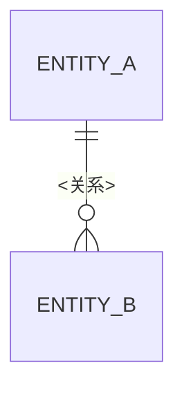

# 数据模型

## 实体关系

## 实体
### <实体名>
| 字段 | 类型 | 必填 | 默认值 | 约束说明 |
|---|---|---|---|---|
| id | <类型> | 是 | 无 | 主键 |
| <字段> | <类型> | <是/否> | <默认值> | <长度、范围、格式，带单位和边界> |

## 枚举
### <枚举名>
| 值 | 含义 | 说明 |
|---|---|---|
| <值> | <含义> | <说明> |

## 约束
- 唯一性：<字段组合>
- 级联：<删除或更新时的行为>